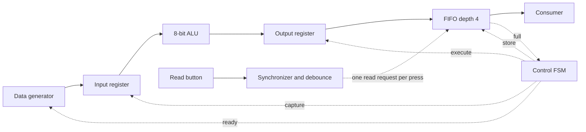

# 8-bit RTL Data Processing Unit

A personal learning project in VHDL-2008: generate two operands, process them
with a small ALU, and queue the results for an external consumer. The aim is to
understand synchronous RTL, register timing, FSM control, FIFO buffering and
self-checking simulation.

The default design has been simulated with GHDL and synthesized through
GHDL and Yosys. It has not been tested on an FPGA board.

## Architecture



Eight RTL modules implement the data path and button input:

| Module | Purpose |
| --- | --- |
| `data_generator` | Deterministic A, B, OP sequence; advances on valid/ready acceptance |
| `input_register` | Holds the accepted operands and operation |
| `alu8` | ADD, SUB, AND, OR; arithmetic wraps modulo 256 |
| `output_register` | Holds the computed result, including during FIFO backpressure |
| `fifo_sync` | Single-clock FIFO with registered read response and occupancy |
| `control_fsm` | CAPTURE → EXECUTE → STORE; waits in STORE when full |
| `button_debounce` | Two synchronizer stages, stable-sample filter and one pulse per press |
| `system_top` | Connects the modules and exposes read/status/observation signals |

All sequential logic uses one clock and active-high synchronous reset.
The generator transaction is accepted on a rising edge with valid and ready
high. Its inputs are captured at that edge; the result is registered one edge
later and written to the FIFO on the following edge if space is available.
Without stalls, the design accepts one transaction every three cycles.

The FIFO defaults to 8-bit data and four entries. Explicit pointer wraparound
also supports depth 1 and non-power-of-two depths. A read request succeeds only
when nonempty; its data and `read_valid` are available after the accepting edge.
When full, simultaneous read/write accepts only the read. When empty, it accepts
only the write, with no bypass. Reset discards all queued and pending results.
See [architecture and interface timing](docs/architecture.md) for the full contract.

## Button-controlled reads

`read_button` is active high: 0 means released, 1 means pressed. Keep `read_en`
at 0 for manual operation. A qualified press produces `button_read_pulse` for
one cycle; the FIFO processes that request on the following rising edge.
Holding the button does not repeat reads. A stable release is required before
another press can trigger a read. The first four results after reset are
255, 255, 0 and 11, in that order.

The top generic `BUTTON_STABLE_CYCLES` defaults to 500,000 consecutive stable
samples for both press and release. The nominal filter duration is
`BUTTON_STABLE_CYCLES / clock_frequency_hz` seconds: for example, 10 ms at
50 MHz, plus synchronization latency. There is no assumed board clock; choose
the generic for the actual clock. Tests use four cycles to keep simulation short.

Automatic `read_en` and the button pulse are ORed together. If they coincide,
there is one read. A request reaching an empty FIFO is discarded, not queued;
`read_valid` is the indication of a successful read. Reset clears the filter
and any pending pulse. A button held through reset is treated as a fresh press
after synchronization and qualification. The button is optional and defaults
to 0 when unconnected in a named instantiation.

## Layout

```text
rtl/                   Eight synthesizable modules
tb/                    Four self-checking VHDL testbenches
docs/architecture.md   Interfaces, FSM timing, FIFO and button rules
Makefile               Simulation, waveform and synthesis commands
.gitignore             Excludes generated build/ files
```

## Tools and commands

Tested with GHDL 4.1.0 (mcode backend), Yosys 0.33 and GNU Make on Ubuntu.
GTKWave is used to view waveforms. No FPGA board, vendor tools, GHDL Yosys plugin
or Python verification framework is required.

Run from the project directory:

```sh
make test       # Four testbenches; FIFO depths 4/1/3 and button thresholds 4/1
make wave       # Run the system test, then open build/system.ghw in GTKWave
make synth      # GHDL -> Verilog -> Yosys generic synthesis, structural check, statistics
make clean      # Remove build/
```

To generate the waveform without opening a desktop window:

```sh
make analyze
ghdl --elab-run --std=08 --workdir=build tb_system_top --assert-level=error --wave=build/system.ghw
```

Useful waveform signals: `source_valid`, `source_ready`, `source_a`, `source_b`,
`source_op`, `result_pending`, `result_data`, `fifo_level`, `fifo_full`,
`read_en`, `read_button`, `button_read_pulse`, `read_valid`, `read_data`, and
`controller.state` inside `dut`. Button scenarios start near 38 us in the system
waveform. Inside `dut.button`, inspect `button_meta`, `button_sync`, `debounced`
and `count` to follow synchronization and filtering.
Inspect signals immediately before an edge for acceptance and after the edge
for updated registers. Testbenches allow 1 ns for signal updates before checking.

## Verification performed

The following checks passed locally:

| Testbench | Checks and observed results |
| --- | --- |
| `tb_alu8` | All 262,144 binary A/B/OP combinations, including overflow, underflow, zero and maximum values; integer reference model |
| `tb_fifo_sync` | Reset, ordering, full/empty, blocked requests, repeated pointer wraparound, simultaneous requests, data hold and recovery; depths 4, 1 and 3, with 2,000 deterministic pseudorandom request cycles per depth |
| `tb_button_debounce` | Thresholds 4 and 1; exact pulse timing, short glitches, press/release bounce, held button, stable release/rearm, reset during qualification and during a pulse, held input through reset; five expected pulses per run |
| `tb_system_top` | Original automatic-read scenarios: 1,018 accepted transactions, 1,008 checked responses, 10 deliberately discarded by reset, 728 full-stall cycles. Additional button scenarios check ordered results, one read per bounced/held press, release/rearm, coincident automatic requests, empty FIFO and reset cancellation |

The FIFO reference model uses a shifting queue rather than DUT-style pointers.
The system scoreboard uses the accepted transaction index to compute expected
results. The two integration epochs each exceed 256 returned results, exercising
both generator rollover and many FIFO pointer wraps. Final accounting checks
that every accepted transaction was either checked or deliberately reset away.
The complete system verification is directed plus deterministic pseudorandom
simulation, not exhaustive verification.

## Synthesis performed

`make synth` succeeded for the depth-4 top with the default 500,000-cycle
button threshold. GHDL recognized the 4×8-bit
FIFO memory. Yosys generic synthesis mapped it to registers; its final
hierarchical statistics were:

| Item | Result |
| --- | ---: |
| Generic cells | 435 |
| Flip-flop cells | 117 |
| Combinational cells | 318 |
| Remaining memories / processes | 0 / 0 |
| Inferred latches | 0 |

The 117 flip-flop cells comprise 32 `$_DFFE_PP_`, 54 `$_SDFFE_PP0P_`,
8 `$_SDFFE_PP1P_` and 23 `$_SDFF_PP0_`. Yosys `check -assert` passed.
The detailed synthesis log is generated at `build/yosys.log`.
These are generic logic statistics, not FPGA LUT, block RAM, frequency or
area measurements. Tool versions and exposed observation ports affect results.

## Limitations

- Educational RTL, with no hardware, timing-closure or post-synthesis simulation validation.
- One transaction in flight outside the FIFO; throughput prioritizes easy timing analysis.
- The generator is internal and repeats after 256 transactions. The system test
  exercises that sequence; only the standalone ALU input space is exhaustive.
- The read interface has no response backpressure: a consumer must accept each
  response to its own read request.
- Reset intentionally drops pending work and must be applied before normal use.
- The button synchronizer reduces metastability propagation risk; RTL simulation
  does not model or validate physical metastability. No board pin mapping or
  placement/timing constraints are supplied.
- One clock domain, with one asynchronous button input. No communication
  interfaces, processor or vendor IP.

For an interview, I would explain the two registers first: the input register
keeps one accepted transaction stable for the combinational ALU, and the output
register preserves its result until the FIFO can accept it. The FSM gives each
transfer a separate rising edge, so a process never writes a register's new value
before VHDL has updated that signal. When the consumer stops, the FIFO fills,
STORE waits, and the generator holds its next transaction. When reads resume,
the pending result is queued and normal processing continues in order.
