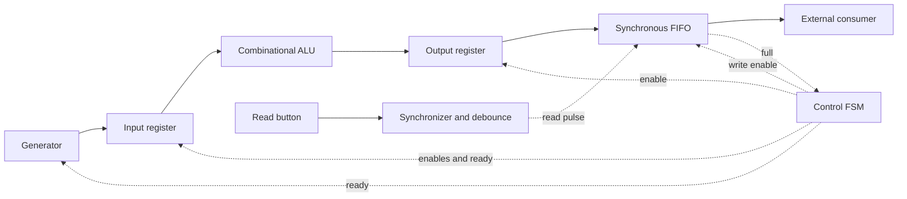

# Architecture and timing

All state changes on the rising clock edge. Reset is active high and synchronous;
it clears registers, pointers, occupancy and the generator sequence. Reset discards
all pending transactions. Combinational transfer enables are held low during reset.

## Data path

The generator offers valid continuously outside reset. Transaction n has
A = n mod 256, B = (255 + 3*n) mod 256 and OP = n mod 4.
Only a rising edge with source_valid and source_ready advances the sequence.
All transaction signals remain stable while ready is low.

## Controller

| State before edge | Action on that edge | Next state |
| --- | --- | --- |
| CAPTURE | If source_valid, capture A, B, OP; acknowledge generator | EXECUTE on acceptance |
| EXECUTE | Capture combinational ALU result in output register | STORE |
| STORE, FIFO has room | Write the previously registered result | CAPTURE |
| STORE, FIFO full | Keep output register unchanged | STORE |

For an acceptance at edge k, the ALU result is captured at k+1 and written
to the FIFO at k+2 at the earliest. The next acceptance is at k+3.
The separate EXECUTE and STORE states ensure that clocked processes see the
correct previous register values under VHDL signal assignment semantics.
`result_pending` is high in STORE; `result_data` is the output register.
There is at most one transaction outside the FIFO. There is no pipelining.

## Interfaces

- Generator: `valid`, `ready`, `a`, `b`, `op`.
- Input register: `enable`, `a_in`, `b_in`, `op_in`, matching outputs.
- ALU: `a`, `b`, `op`, `result`; ADD/SUB wrap modulo 256.
- Output register: `enable`, `data_in`, `data_out`.
- Controller: `source_valid`, `fifo_full`; outputs `source_ready`,
  `input_enable`, `output_enable`, `fifo_write`, `result_pending`.
- FIFO: generic positive `DATA_WIDTH` (8), `DEPTH` (4); `write_en`,
  `write_data`, `read_en`, `read_data`, `read_valid`, `full`, `empty`, `level`.
- Button: generic positive `STABLE_CYCLES` (500,000); active-high `button_in`
  and registered one-cycle `press_pulse`.
- Top: generic positive `FIFO_DEPTH` (4), `BUTTON_STABLE_CYCLES` (500,000);
  `read_en` and active-high `read_button` inputs (both default 0), observed
  `button_read_pulse`, external FIFO read response/status, source handshake/
  transaction and pending result observation ports.
- Every sequential module has `clk` and `rst`.

## FIFO contract

Acceptance uses occupancy **before** the edge. A write is accepted iff
write_en=1 and full=0; a read iff read_en=1 and empty=0.

| Occupancy before edge | Both enables asserted |
| --- | --- |
| Empty | Write only; no bypass to read output |
| Between empty and full | Read oldest entry and append new entry; level unchanged |
| Full | Read only; write rejected, including at depth 1 |

This conservative full policy costs a cycle after a full read, but gives a simple
rule shared by the FIFO and controller. Pointers wrap explicitly at DEPTH-1,
so non-power-of-two depths and depth 1 work. Rejected requests do not advance
pointers. Memory contents need not be reset; occupancy prevents stale reads.

`read_en` requests a read. After an accepted edge, `read_valid` is high and
`read_data` holds that edge's oldest entry for the following cycle. Consecutive
reads can keep read_valid high. When no read is accepted, read_valid is low
and read_data holds its last value. There is no response ready signal: the
consumer must accept each response to its own request. This is a registered
read interface, separate from the source valid/ready interface.

## Button input

`read_button` passes through two flip-flops clocked by the same `clk` as the
rest of the system. Only the second stage feeds the debounce logic. This
reduces metastability propagation risk; digital RTL simulation cannot validate
the analog behavior or a physical implementation's reliability.

The filter accepts a change only after `BUTTON_STABLE_CYCLES` consecutive
samples of the synchronized input differ from the current debounced state.
A sample equal to the current state resets the counter. Both press and release
are filtered. Acceptance of a high state produces one `button_read_pulse`;
acceptance of a low state only rearms the button. Thus holding high cannot
repeat a read, and a short release glitch cannot rearm the circuit.

For a clean press starting from a settled low state, with its first raw high
sample at edge k and threshold N:

| Edge | Action |
| --- | --- |
| k | First synchronizer stage samples high |
| k+1 | Second synchronizer stage becomes high |
| k+2 | Filter consumes its first high sample |
| k+N+1 | Nth high sample qualifies; pulse becomes high after this edge |
| k+N+2 | FIFO consumes the pulse; read response follows this edge if nonempty |

The default threshold is 500,000 cycles, nominally 10 ms at 50 MHz; set it for
the actual clock frequency. Threshold 1 is supported but provides no rejection
of single synchronized samples. Unit tests exercise thresholds 4 and 1;
the integration test uses 4.

The FIFO read request is `read_en or button_read_pulse`. This keeps the automatic
interface available; a coincident automatic and button request consumes only
one entry. With `read_en=0`, each qualified press attempts one read. If the FIFO
is empty at the accepting edge, the request is ignored, including when a write
arrives on that same edge. There is no saved button request and no automatic
retry when data later arrives. Use `read_valid` to identify an actual response.

Reset clears both synchronizer stages, the debounced state, the counter and
the pulse. It cancels an outstanding read pulse along with the FIFO contents.
If the physical input stays high through reset, it qualifies as a fresh press
after reset. In button-only mode, the first four reads after the FIFO fills
return 255, 255, 0 and 11.
